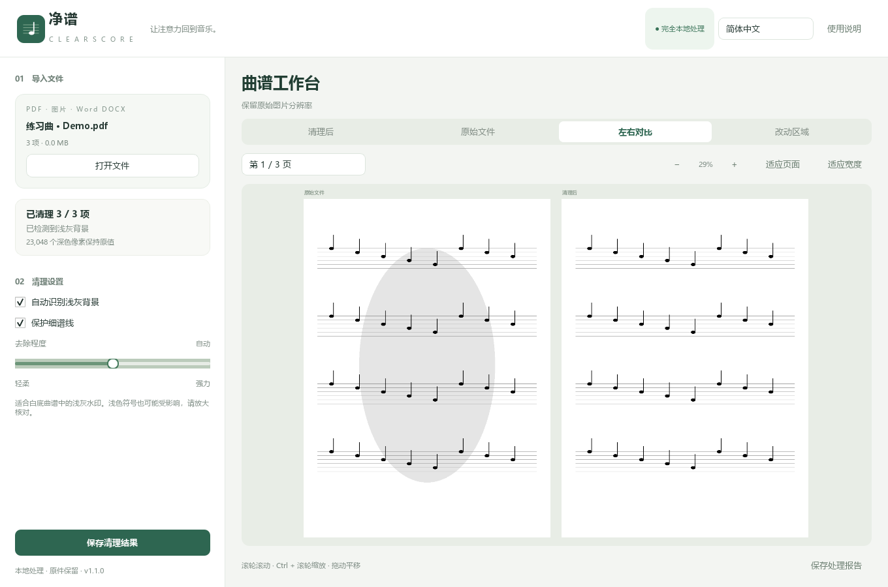

# 净谱 · ClearScore

一款本地运行的曲谱浅灰水印清理工具，支持 PDF、图片和 Word DOCX，以及中文、English、Русский、ئۇيغۇرچە 四种界面语言。

拖入文件，自动分析浅灰背景，对比效果，再保存清理结果。无需账号、API、网络或命令行操作。



## 使用

Windows 便携版：解压发布包，双击文件夹里的 **净谱.exe**。保留旁边的 `_internal` 文件夹。

1. 点击「打开文件」，或直接拖入文件。
2. 自动清理后，用「原始文件 / 左右对比 / 改动区域」核对结果。
3. 需要调整时，关闭自动，调节「去除程度」。向右会清理更深的灰色。
4. 保持「保护细谱线」开启，放大检查较浅的数字与符号。
5. 点击「保存清理结果」，保存为新文件。

滚轮滚动；`Ctrl + 滚轮` 缩放；鼠标拖动平移；「适应页面」显示整页；「适应宽度」放大至窗口宽度。

## 支持的格式与语言

| 输入 | 默认输出与处理方式 |
| --- | --- |
| PDF | PDF；仅替换支持的嵌入图片，保留页面绘制指令 |
| JPG / JPEG / JFIF、PNG、BMP / DIB、WebP | PNG；也可另存 TIFF、无损 WebP、PDF 或 JPEG |
| TIFF、GIF、APNG、动态 WebP | 所有页或帧均处理，多页 TIFF 或 PDF 输出；不保留动画时序 |
| HEIC / HEIF、AVIF、JPEG 2000、ICO、TGA、PPM / PGM / PBM / PNM | 解码后清理，默认无损 PNG；不导出 HEIC |
| Word DOCX | DOCX；只替换嵌入图片，保留正文、样式、表格和版式 XML |
| 旧版 Word DOC | 先在 Word 中另存为 DOCX，再导入 |

透明图片保留 alpha 通道；半透明和全透明像素不改。EXIF 方向会先归正，再保存显示方向一致的图片。非 RGB / 灰度的独立图片可能转为 RGB，并在报告中说明。JPEG 输出会再次有损压缩，保存前会明确提示。

Word 预览显示**文档中的嵌入图片，不是排版后的文档页**。输出仍是可编辑的 DOCX，不依赖 Word 或 LibreOffice。Word 的浮动文字水印、矢量图形、外链图片和旧版 DOC 不自动清理。只含文字、没有支持图片的 DOCX 会给出说明。

右上角可随时切换四种语言，下次打开会记住选择。语言覆盖按钮、状态、错误、帮助、保存提示；维吾尔语使用右到左布局，乐谱不镜像，数字和文件名保持独立方向。文案按功能场景编写，术语与复核说明见 [本地化说明](docs/LOCALIZATION.md)。

## 能做什么

- 检测白底、深色曲谱图片中的显著浅灰背景峰值。
- 处理扫描 PDF 中的大幅 RGB / 灰度图片，包括多页共用的图片。
- 阈值以下的深色像素逐像素保持原值，彩色像素不清除。
- 检测长水平谱线，保护其中的较浅线段。
- 保留原始图片像素尺寸、PDF 页尺寸、裁剪、旋转、元数据与页面绘制内容流。
- 仅替换被处理图片的数据，采用无损 Flate 压缩，避免再次 JPEG 压缩。
- 所有清理在工作线程执行；可取消；导出采用临时文件后原子替换。
- 源文件禁止覆盖，处理报告可以另存为 JSON。

## 适用范围与真实限制

本软件按**亮度与颜色特征**识别背景，不识别人脸、吉他、音乐语义，也不使用生成式 AI、OCR 或重新制谱。

水印与乐谱已合成为同一张图片时，无法从这张图片精确恢复覆盖前的像素。软件承诺的是可验证的深色像素保护，而不是任意曲谱内容绝对不变。位于阈值及以上的浅色谱面细节仍可能变白，须通过预览核对。

| 输入 | 行为 |
| --- | --- |
| 白底黑谱、浅灰背景、整页图片 PDF | 主要适用场景 |
| 纯矢量 PDF、内联图片、独立矢量水印 | 保持原样，界面标明未处理页 |
| 照片、大面积彩色背景 | 自动模式通常跳过 |
| PDF 中的 CMYK、透明蒙版图片 | 跳过，避免改变 PDF 原有颜色或蒙版关系 |
| 深色水印、与音符同色的水印 | 不保证可分离 |
| 含密码、表单或签名 | 默认拒绝或要求先另存为普通 PDF |

自动检测可能将浅灰插画、装饰或合法浅色内容视为背景，因此请核对导出结果。不要把“已处理”理解为音乐语义已验证。

单次限制：300 MB、300 页或帧；单张图片 6000 万像素。独立图片和 DOCX 的累计解码像素最多 6000 万，以控制内存。复杂文件的实际内存占用可能高于文件大小。当前 Windows x64 版本已验证，其他系统可从源码运行，未提供打包保证。

## 从源码运行

需要 Python 3.12+（当前 Windows 构建使用 Python 3.12）。

```powershell
python -m venv .venv
.\.venv\Scripts\python -m pip install -r requirements-dev.txt
.\.venv\Scripts\python run.py
```

依赖的精确版本记录在 `requirements.txt` 中。安装过程需要联网；软件运行和处理文件不需要网络。

## 测试与构建

```powershell
.\.venv\Scripts\python -m pytest -q
.\.venv\Scripts\python scripts\ui_preview.py
.\.venv\Scripts\python scripts\build_windows.py
```

可选地设置 `CLEARSCORE_SAMPLE_PDF` 环境变量，以针对本地私人样本执行像素回归验证。测试数据不会被提交或上传。

测试另覆盖图片解码、alpha 保护、EXIF、多帧保留、DOCX 结构与关系、原件防覆盖、四语切换和维吾尔字形。原有测试涵盖自动检测、深色像素保护、细谱线保护、颜色保留、无水印图跳过、旋转与裁剪、多页共享图片、矢量内容流保留、原文件保护、取消、错误文件、加密文件，以及 GUI 导入、切换对比、调参和导出。

构建产物：`dist/ClearScore/净谱.exe` 和 `release/ClearScore-1.1.0-windows-x64.zip`。使用目录式动态链接，Qt DLL 位于 `_internal/PySide6`，可以替换为兼容版本。依赖许可证随便携包分发。

构建脚本会实际启动打包后的程序，验证 PDF、PNG、TIFF、DOCX、AVIF、HEIC 的处理、对比预览与导出，并覆盖四种语言，成功后才生成 ZIP。它也会排除宿主机 PATH 中可能误带入的同名 ICU 库，让 Qt 使用 Windows 系统提供的 ICU 接口。

## 项目结构

```text
clearscore/core.py       图像分析、清理、PDF 保留与校验
clearscore/formats.py    图片与 DOCX 保真读写、统一导出
clearscore/i18n.py       四语文案、双向文字保护
clearscore/app.py        PySide6 多语言桌面界面
clearscore/preview.py    PDF 预览及差异显示
tests/                  合成样本与回归测试
scripts/                截图、构建与许可证收集
.github/workflows/      自动测试与 Windows 构建
docs/                   发布说明、界面截图
```

## 开源

本项目代码采用 MIT 许可；依赖保留各自许可证，详见 [第三方声明](THIRD_PARTY_NOTICES.md)。示例截图由程序生成的测试图组成，不包含用户曲谱。

GitHub 发布步骤见 [发布指南](docs/PUBLISHING.md)。项目不包含用户 PDF、处理结果、私人样本或本机配置。

源码发布使用明确的文件清单，并检查凭据、本机身份和演示素材。运行 `python scripts/package_source.py` 可生成经过检查的源码 ZIP；无需已有 Git 仓库。隐私检查范围、文档元数据说明及提交邮箱设置见 [隐私说明](docs/PRIVACY.md)。
